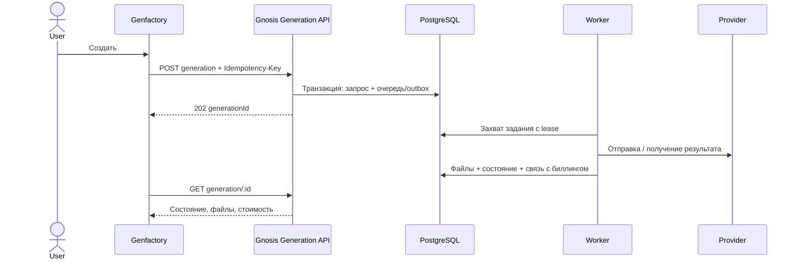

# Архитектура Genfactory

Genfactory — интерфейс творческой студии поверх gnosis. Пользователь выбирает результат («изображение» или «видео»), описывает идею, добавляет референсы и получает сохранённый материал. Gnosis остаётся единственным владельцем аккаунтов, моделей, выполнения генерации, файлов и финансовых операций.

Согласованный объём первого релиза: изображения и видео, существующие аккаунты и балансы gnosis, переработанный интерфейс в духе Higgsfield. Перенос старых аккаунтов, балансов и истории Genfactory — отдельный проект.

## Продукт и навигация

| Раздел      | Задача пользователя                                              | Источник данных                                            |
| ----------- | ---------------------------------------------------------------- | ---------------------------------------------------------- |
| Обзор       | Найти направление и начать создание                              | Редакционная подборка Genfactory, стартовые промпты        |
| Изображения | Создать изображение по тексту или референсам                     | Каталог моделей, task API, file API                        |
| Видео       | Создать ролик по тексту или кадрам                               | Каталог видеомоделей, task API, готовый файл               |
| Библиотека  | Найти, открыть, скачать оригинал, использовать изображение снова | Файлы текущего пользователя gnosis                         |
| История     | Посмотреть параметры, состояние и стоимость запуска              | Пока журнал браузера; в целевой версии серверные поколения |
| Аккаунт     | Посмотреть профиль и остаток средств                             | `/api/init`                                                |

Отдельные вкладки «Nano Banana», «Seedance» и другие названия из старого сайта не становятся отдельными подсистемами. Это модели внутри соответствующего сценария. Доступность определяется каталогом gnosis; брендированная карточка не является доказательством поддержки модели.

Не входят в первый релиз: публичная лента пользователей, монтажная timeline, обучение персональных моделей, AI-агенты, маркетинговая фабрика, команды, тарифные подписки, самостоятельный платёжный шлюз. Ссылки на несуществующие функции не добавляются.

## Визуальная система

Основа взята из `projects/genfactory/site/design-system/tokens.css` на исходном сервере: фон `#0b0b0c`, поверхности `#151617`, светлый текст и лайм `#d1fe17`. Используются Inter и Manrope, спокойная навигация, крупные медиа, компактные настройки, заметная единственная кнопка запуска.

На главной — две понятные точки входа и подборка идей. В редакторе — панель ввода и отдельная область результатов. На мобильном панели идут последовательно; навигация открывается отдельным меню. Поддерживаются клавиатура, нативные модальные диалоги с Escape и focus trap, видимый focus, `prefers-reduced-motion`, подписи полей и отсутствие горизонтального скролла.

Логотип и палитра сохраняют Genfactory. Higgsfield служит ориентиром взаимодействия и плотности визуального интерфейса; его бренд и медиа не копируются. Медиа в `public/media` получены с существующего сайта пользователя.

## Технический стек и границы

React + TypeScript + Vite подходят для интерактивной авторизованной студии, которую можно разместить как статические файлы за существующим reverse proxy. В первом релизе нет потребности в SSR для каждой приватной страницы. Публичный маркетинговый сайт и SEO-страницы можно развивать отдельно, не связывая с состоянием генераций.

TanStack Query хранит серверные выборки: аккаунт, каталог, библиотеку. Ключи включают пользователя и параметры выборки; смена аккаунта очищает кэш. React хранит состояние формы. Отдельный модуль генераций продолжает обрабатывать ответ при переходе между страницами. Ajv проверяет полный запрос по полученной JSON Schema, включая условные ограничения.

```text
src/app                  оболочка, маршруты, обзор
src/components           доступные общие элементы и медиа-просмотр
src/features/auth        сессия, callback, текущий пользователь
src/features/catalog     схемы, значения по умолчанию, ограничения
src/features/studio      редактор, жизненный цикл запуска, история
src/features/library     файлы и повторное использование
src/features/account     профиль и баланс
src/lib/api.ts           единственная граница HTTP с gnosis
src/lib/types.ts         небольшой UI-контракт без ORM и NestJS
src/styles               дизайн-система и адаптивность
```

В компонентах нет вызовов OpenAI/OpenRouter, API-ключей провайдеров, SQL или расчёта списаний. Backend DTO с NestJS-декораторами не импортируются в браузер. Схемы моделей получаются во время работы; стабильные транспортные типы проверяются на контрактных fixtures. Позже стоит генерировать стабильные DTO из опубликованного OpenAPI в CI, сохранив адаптеры между транспортом и UI.

React-компоненты используют композицию. Классы оправданы для ошибок и инфраструктурных адаптеров, а не для иерархии экранов. Каталог, ввод, генерация и медиа не наследуются от общего «универсального компонента». При переходе на серверные generation API модуль выполнения заменяется за той же границей; разметка карточек результата остаётся.

## Каталог и параметры

Единица выбора — пара `{ provider, model }`: например, адаптер `OPEN_AI_IMAGE_GPT` и конкретная модель внутри него. Их нельзя смешивать в одно поле. Список загружается из `/api/aimodels`; request schema определяет task, options, defaults, enum, диапазоны и условные правила.

При смене модели параметры сбрасываются к её схеме: параметры предыдущего провайдера не попадают в новый запрос. Дополнительные поля показываются отдельно, инфраструктурные routing/streaming параметры скрыты. Референсы доступны только при наличии соответствующего поля схемы. Frontend ограничивает количество изображений своим UX-пределом (не больше четырёх), не превышая `maxItems` модели. Маски и специализированные endpoint passthrough-параметры остаются для следующего этапа.

У видео часть полей в текущем каталоге имеет тип без enum/границ. UI не выдумывает поддерживаемые длительности или разрешения: позволяет ввод по типу и передаёт окончательную проверку backend. Для публичного релиза нужен более точный видеокаталог (см. backend-контракт).

## Выполнение сейчас

1. Получить пользователя и каталог, выбрать модель, сформировать task/options.
2. Загрузить референсы в gnosis, получить file IDs или URL для кадров видео.
3. Сформировать уникальную session и проверить запрос по JSON Schema.
4. Заблокировать второй запуск для этого аккаунта в текущей вкладке.
5. Единожды вызвать `/api/task`. При переходе на другую страницу обработчик остаётся жив.
6. Сохранить изображения через `/api/fileBuffer`; для видео получить готовый файл по `fileId`.
7. Обновить библиотеку и баланс. Показать стоимость с отдельным состоянием `PENDING`, `FINAL` или `UNAVAILABLE`.

У генерации и сохранения разные состояния. Ошибка сохранения не запускает модель повторно. В памяти остаются ещё не сохранённые изображения, чтобы повторить только сохранение. Сетевой сбой генерации или 5xx означает неопределённый исход: запрос мог быть выполнен и оплачен. Автоматического retry для платных POST нет.

Локальный журнал хранит до 100 записей на пользователя с параметрами и метаданными файлов, без токенов и base64 результатов. После перезагрузки незавершённая запись становится `unknown`. Локальный журнал не называется серверной историей и не используется как доказательство выполнения или списания.

Ограничение: текущий backend не имеет идемпотентного file-save API, поэтому потеря ответа сохранения тоже может привести к дублированию файла при ручном повторе; модель при этом не вызывается повторно. Серверная атомарная привязка результатов к generation устраняет это окно.

## Целевое выполнение перед публичным запуском

Браузер должен отправлять короткий запрос создания generation и получать `202 + generationId`. В PostgreSQL сохраняются автор, нормализованный запрос, его hash, ключ идемпотентности, состояние, внешние job IDs, ссылки на файлы и стоимость. Worker доводит выполнение и сохраняет результат независимо от браузера. UI получает статус polling с backoff; события могут ускорять обновление, но не являются единственным источником истины.



Такое изменение не требует второго AI-backend в Genfactory. Обёртка в gnosis использует существующие TaskExecutionService, AiAsyncJobService и TaskBillingService, сохраняя их финансовые гарантии.

## Авторизация и финансы

Текущий frontend использует публичную конфигурацию Keycloak, случайный OAuth state, проверку срока и обмен code через gnosis. Backend выполняет обмен с confidential client. SID хранится только в `sessionStorage` и отправляется Bearer; ни client secret, ни provider keys в браузере нет. Поле ручного токена доступно только в development.

До production нужно исправить серверный logout (сейчас он не отзывает SID), ввести срок действия и отзыв сессий. Предпочтительная целевая схема для браузера — HttpOnly/Secure cookie gnosis за тем же origin, с CSRF-защитой изменяющих запросов и проверкой Origin. Старый Bearer API сохраняется для существующих клиентов. Если это невозможно, тонкий auth BFF может держать SID на сервере; он не должен копировать генерации, пользователей и биллинг. Для полноценного PKCE требуется поддержка verifier в серверном обмене code.

Остатки показываются в валюте gnosis, без придуманных «кредитов». Суммы разных валют не складываются. `UNAVAILABLE` не означает бесплатно, `PENDING` не означает окончательно списано. В UI пока нет пополнения, поскольку в текущем API нет checkout endpoint. В следующей версии checkout создаёт backend; баланс изменяется только после проверенного webhook.

## Проверки и выпуск

Нужны три уровня: unit для схем/переходов состояния, browser E2E с перехватом API для сценариев пользователя и read-only smoke с настоящим gnosis. Отдельно перед релизом — тестовая платная генерация каждой поддержанной категории с проверкой файла и проводки, по согласованному бюджету. Моки не доказывают доступность внешних моделей.

Оставшиеся release gates: постоянная история/идемпотентность, управляемые сессии, точные ограничения видео, проверка доступа к media URLs, производственные таймауты/лимиты, реальный OAuth redirect и smoke на staging. Перенос старых пользователей и публикация не выполняются автоматически.

## Почему не переносить старый код целиком

Старый сайт реализован HTML и крупными JS-модулями вокруг `/api/studio`, собственной истории и собственных аккаунтов. Замена только URL оставила бы несовместимые состояния и двойную финансовую логику. В новую реализацию переходят бренд, визуальные материалы и удачные сценарии. Транспорт и доменная логика строятся вокруг проверенных контрактов gnosis.

Технические источники: [Vite](https://vite.dev/guide/), [TanStack Query](https://tanstack.com/query/latest/docs/framework/react/overview). Продуктовые ориентиры: [Genfactory](https://genfactory.ru/#home), [Higgsfield](https://higgsfield.ai/). Фактические API-ограничения проверены по локальному коду `gnosis-backend`, включая TaskService, Login/LogoutController, FileBufferAddController и каталог моделей.
